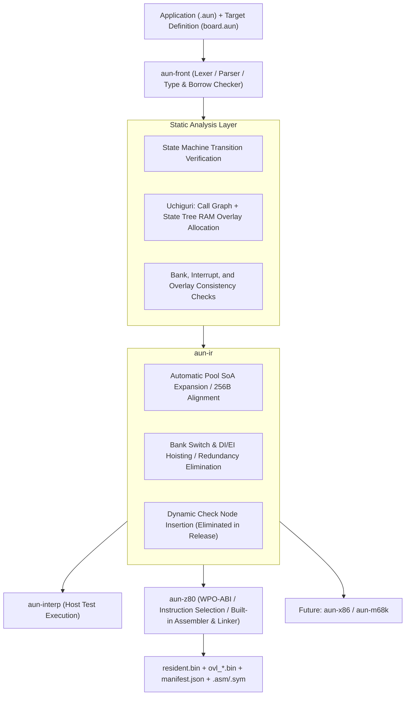

# Aun Language and Compiler Design Specification v1.0

> [!NOTE]
> **Aun** (Japanese: 阿吽) is a systems programming language and integrated development toolchain designed for the Z80 (and future 8086 / 68000 targets), centered on **first-class state machines** and **static memory layout**.
>
> The name draws from three ideas: the Buddhist sculptor's tradition of *ichiboku-zukuri* (carving a statue directly out of a single tree trunk, hollowing out the interior via *uchiguri*), the paired *Kongōrikishi* temple guardians (*Agyō* and *Ungyō*) standing watch against invalid state (representing static and dynamic checks), and *A-Un*—the beginning and the end—expressing state machines operating in seamless harmony with the Z80.

---

## 1. Architectural Decisions (Finalized)

| ID | Area | Decision |
| :-: | :--- | :--- |
| **AD-1** | Language Name, CLI, Extension | **`Aun`** / CLI: `aun` / File extension: `.aun` |
| **AD-2** | Compiler Implementation Language | **Rust** (multi-crate workspace) |
| **AD-3** | Static Memory Safety (Borrow Model) | **Second-Class References** (`&T` / `&mut T` allowed only in function parameters and local scopes; prohibited in `struct` or `state` fields) + **static constant slices (`&const [T]`)** + **1-byte `Handle<T>` for `Pool`**. Statically prevents dangling references and aliasing with zero lifetime annotations |
| **AD-4** | FFI with Existing Assets | **Register-explicit FFI** (declaring arguments, return registers, and `clobbers`) supported from the start to allow incremental migration alongside existing assembly such as `bbb88`'s `hal_pc88.s` and `mdxnt` |
| **AD-5** | Code Generation & Linking | **Built-in Z80 assembler and whole-program linker** (full control over WPO, static RAM overlays, multi-overlay binaries, and T-state calculation). Emits `.asm` dumps, symbol tables, and manifests for inspection |
| **AD-6** | Dynamic Check Traps & Granularity | **User-defined panic handler** (defaults to emulator trap port output / `RST` + halt loop). Checks can be toggled **build-wide as well as per module or function** |
| **AD-7** | Host Test Execution | Executed via a **built-in IR interpreter** (no external C compiler required; provides rich diagnostics for state transition history and check violations) |
| **AD-8** | First MVP Goal | **Rewrite part of `bbb88`'s `physics` / `stage1`** and benchmark code size and T-states on QUASI88 against the SDCC and hand-written ASM versions |
| **AD-9** | Existing ASM Interop | Built-in Z80 assembler includes an **SDASZ80 (`.s`) compatible parser**, allowing existing assembly files (e.g., `hal_pc88.s`, `mdxnt`) to be assembled and linked directly |
| **AD-10** | Overflow & Saturation Operators | Separated by operator: standard (`+`, `-`, `*`) traps in Debug and wraps in Release; `+|`, `-|`, `*|` saturate; `+%`, `-%`, `*%` explicitly wrap without trapping |
| **AD-11** | State `goto` Control Flow | `goto TargetState { ... }` is a **diverging expression (`!`)**: immediately runs `on_exit` -> state update -> `on_enter` and exits the current handler |
| **AD-12** | `Pool<T, N>` Handle Layout | `Handle<T>` is **always 1 byte (`u8`)** (`N <= 255`) in both Debug and Release; Debug uses a separate side table for UAF/bounds checks, eliminated (0 bytes) in Release |

### Detailed Specifications
- [Language Reference](language-reference.md)
- [Target Definitions, *Uchiguri* Memory, Banks, and Overlays](target-and-memory.md)
- [IR (`aun-ir`) and Host Interpreter (`aun-interp`)](ir-and-interpreter.md)
- [Z80 Backend, WPO-ABI, and Built-in Assembler/Linker (`aun-z80`)](z80-backend.md)

---

## 2. Overall Compiler Architecture



---

## 3. Core Language Specification (Syntax and Semantics)

### 3.1 Type System (Z80-First)

* **Strict integer types (no implicit 16-bit promotion)**: `u8`, `i8`, `u16`, `i16`, `u32`, `i32`, `bool`. Mixed-width operations require explicit `as` casts.
* **First-class fixed-point types**: `q8_8` (signed 16-bit, 8 fractional bits), `q10_6` (signed 16-bit, 6 fractional bits), and generic `fixed<Base, FracBits>`.
  - `v.int()` reads the high byte (`H`) directly for `q8_8` (0T shift), and generates an optimized 2-bit left shift + high-byte extraction for `q10_6`.
* **References and handles (AD-3)**:
  - `&T` / `&mut T`: Permitted only for function parameters and local variables (storing them in `struct` or `state` fields is a compile-time error). `&mut T` is exclusive within its scope (aliasing is forbidden).
  - `&const [T]`: Read-only slice pointing to ROM / static constant data. May be stored in `struct` and `state` fields.
  - `Pool<T, N>` and `Handle<T>`: Static object pool holding up to `N` elements (`Handle<T>` is a 1-byte `u8` when `N <= 255`). Annotating with `#[layout(soa, align(256))]` automatically expands fields into separate 256-byte-aligned arrays.

### 3.2 First-Class State Machines (`machine` / `state` / `transitions`)

A state machine is defined as a language-native tagged union with an explicit table of permitted transitions and lifecycle hooks. Nesting another `machine` inside a `state` field uniformly expresses both **Hierarchical State Machines (HSM)** and **orthogonal (parallel) states**.

```aun
machine Ball {
    // Fields shared across all states
    x: q10_6,
    y: q10_6,

    // State-local fields (RAM automatically overlaid across mutually exclusive states = Uchiguri)
    state Inactive;
    state InShooter { power: u8 };
    state InPlay { vx: q8_8, vy: q8_8, skill_timer: u16 };
    state MagnetHeld { hold_timer: u8 };

    // Permitted transition declarations (all other transitions are forbidden)
    transitions {
        Inactive   -> InShooter;
        InShooter  -> InPlay | Inactive;
        InPlay     -> MagnetHeld | Inactive;
        MagnetHeld -> InPlay | Inactive;
    }

    // Per-state handlers (current state is statically known inside each block)
    on InShooter {
        fn on_enter(&mut self) {
            self.power = 0;
        }

        fn step(&mut self, inp: &InputState) {
            if inp.plunger == 0 && self.power > 0 {
                // [Static transition] Verified at compile time against `InShooter -> InPlay` (0 runtime cost).
                // For example, writing `goto MagnetHeld { ... }` is a compile-time error.
                goto InPlay {
                    vx: 0.0,
                    vy: -(self.power as q8_8),
                    skill_timer: 120,
                };
            }
        }
    }

    on InPlay {
        fn step(&mut self, inp: &InputState) {
            // Physics update...
        }
    }
}
```

#### Clear Boundary Between Static and Dynamic Checks

1. **Static transitions (100% compile-time verified, zero overhead)**
   - Inside an `on StateA { ... }` block or a `match ball { StateA(s) => ... }` arm, the current state is statically known to be `StateA` at the type level.
   - Any `goto StateB { ... }` in this context is checked against the transition table at compile time; disallowed transitions are **compile-time errors**.
2. **Dynamic transitions (checked in Debug builds, 0 bytes in Release builds)**
   - When calling `ball.goto(StateB { ... })` from an external event or generic function where the current state is not statically known:
     - **Debug builds**: Dynamically checks whether `(cur, StateB)` is permitted by the transition bitmask, invoking the panic handler (`PanicCode::InvalidTransition`) on violation.
     - **Release builds**: Eliminates the check completely, emitting only the fastest `on_exit` -> state pointer update -> `on_enter` sequence.
   - Adding `#[strict_transitions]` to a module or `machine` forbids dynamic transitions altogether, requiring every transition to occur in a statically narrowed (`on` / `match`) context.

#### Z80 Code Generation
* Instead of an integer tag ID, the state tag directly stores the **dispatch table or handler address** for that state and dispatches via `JP (HL)` (when running from RAM with `#[smc]` enabled, self-modifying `JP xxxx` dispatch is also selectable).

---

### 3.3 Static Memory Allocation & *Uchiguri* (RAM Overlay)

* All local variables, global variables, and state machines are placed at **fixed RAM addresses** by default (zero `IX+d` stack frames).
* The compiler constructs a unified interference graph combining the **function call graph** and the **state machine exclusivity tree**, using graph coloring to assign the same RAM addresses to variables that can never be live simultaneously.
* Interrupt service routine (ISR) call graphs are treated as always interfering with the main thread, guaranteeing 100% separation from main-thread RAM regions.
* Only functions explicitly annotated with `#[reentrant]` use stack frames for recursion.
* At link time, the compiler statically computes the maximum stack depth (maximum call-graph depth x 2 bytes + interrupt nesting save area) and fails the build if it exceeds the declared `stack` budget.

---

### 3.4 Target Definitions: Memory Spaces, Banks, Interrupts, and Overlays

Hardware-specific details are declared once in a target definition file (e.g., `board/pc88sr.aun`).

```aun
// board/pc88sr.aun (PC-8801mkIISR standard: 64KB + 4KB High-Speed RAM)
target pc88sr : z80 {
    space MainRam       @ 0x0100..0xBFFF;
    stack MainStack     @ 0xBE00..0xBFFF; // Max 512B statically verified

    // Multi-banked window at 0xC000..0xFFFF
    bank_group HighWindow @ 0xC000..0xFFFF {
        bank HighMainRam  @ 0xC000..0xEFFF; // Back Main RAM (g_state, ANM2)
        bank HighSpeedRam @ 0xF000..0xFFFF; // High-Speed RAM front (g_cap, TVRAM)
        bank HiddenBgmRam @ 0xF000..0xFFFF requires di; // Hidden 4KB (Port 0x32 bit4=1)
        bank VramAlu      @ 0xC000..0xFFFF requires di; // GVRAM ALU (GAM=1)
        bank VramB        @ 0xC000..0xFFFF requires di;
        bank VramR        @ 0xC000..0xFFFF requires di;
        bank VramG        @ 0xC000..0xFFFF requires di;

        default HighMainRam + HighSpeedRam;

        switch(to) {
            HighMainRam + HighSpeedRam => { io_out(0x35, 0x00); io_out(0x5F, 0); }
            HiddenBgmRam               => { io_out(0x32, shadow_32 | 0x10); }
            VramAlu                    => { io_out(0x32, shadow_32 | 0x40); io_out(0x35, 0x80); }
            VramB                      => { io_out(0x5C, 0); }
            VramR                      => { io_out(0x5D, 0); }
            VramG                      => { io_out(0x5E, 0); }
        }
    }

    interrupt_controller Pc88Int {
        disable => asm!("di");
        enable  => asm!("ei");
        source Vrtc  @ im2(0xF302) { rearm => io_out(0xE4, shadow_e4); }
        source Sound @ im2(0xF308) { rearm => io_out(0xE4, shadow_e4); }
    }

    // Code overlay slot loaded from disk
    overlay_slot SceneCode @ 0x8000..0x9FFF {
        load(id: OverlayId) => hal_load_overlay(id, 0x8000);
    }
}
```

#### Compiler Safety Guarantees and Optimizations
* **Static bank conflict detection**: Accessing a variable `in HighMainRam` directly inside a `with bank(VramAlu) { ... }` scope is a compile-time error because `VramAlu` shadows `0xC000..0xFFFF`.
* **Redundant switch elimination**: Hoists `with bank(...)` out of loops to minimize unnecessary `OUT` and `DI`/`EI` instructions.
* **Top-level state x code overlay integration**:
  ```aun
  machine App {
      total_score: u32, // Placed in resident MainRam

      #[overlay(SceneCode)] state Title      { cursor: u8 }
      #[overlay(SceneCode)] state Stage1     { s1: Stage1State }
      #[overlay(SceneCode)] state ClearTally { tally: TallyState }

      transitions {
          Title      -> Stage1;
          Stage1     -> ClearTally | Title;
          ClearTally -> Title;
      }
  }
  ```
  - Automatically generates the transition dispatcher in resident memory, structurally preventing an active overlay from overwriting itself mid-execution.
  - Links the resident core and all overlays together in one pass, eliminating manual API function-pointer tables.

---

### 3.5 Register-Explicit FFI (Existing Assembly Interop)

Declaration syntax for safely calling existing assembly routines such as `bbb88`'s `hal_pc88.s` or `mdxnt`:

```aun
extern "asm" {
    fn hal_wait_vsync(prev: u8 in A) -> u16 in DE
        clobbers(BC, HL, F);

    fn gfx_fill_rect_alu(col: u8 in A, y: u8 in L, w: u8 in B, h: u8 in C)
        requires bank(VramAlu), di
        clobbers(AF, BC, DE, HL);
}
```

* Explicit `clobbers(...)` annotations preserve caller-side register allocation optimizations.
* `requires bank(...), di` can also be attached to FFI functions so calling preconditions of existing assembly are checked at compile time.

---

### 3.6 Dynamic Checks (Debug) and Panic Handler

| Check Category | What Is Detected | Release Behavior |
| :--- | :--- | :--- |
| `bounds` | Out-of-bounds array/slice/`Pool` indexing, invalid `Handle<T>` dereference | Eliminated (0 bytes) |
| `transition` | Disallowed state transition from a statically unknown state | Eliminated (0 bytes) |
| `overflow` | Integer and fixed-point overflow/underflow | Eliminated (0 bytes) |
| `bank` | Bank state mismatch at dynamic boundaries that cannot be statically resolved | Eliminated (0 bytes) |

* **Granular control**: In addition to CLI flags (`aun build --release` / `--checks=bounds,transition`), checks can be configured per module or function with `#[checks(off)]` or `#[checks(overflow = off)]`.
* **Panic handler**:
  ```aun
  #[panic_handler]
  fn on_panic(code: PanicCode, site_id: u16) -> ! {
      // Default: write code/site_id to emulator monitor port and halt
      io_out(0xFE, code as u8);
      asm!("di; halt");
  }
  ```
  `site_id` is matched against the `.sym` manifest emitted at build time, allowing the emulator to report the exact source file and line number.

---

## 4. Implementation Roadmap (Rust Workspace Layout)

Planned repository layout (`~/Work/aun`):
* `crates/aun-front` — Lexer, Parser, AST, Type Checker, Second-Class Borrow Checker, Static State Machine Verifier
* `crates/aun-ir` — Target-independent IR, *Uchiguri* (static RAM overlay allocator), SoA lowering, Bank/DI optimizer
* `crates/aun-interp` — IR interpreter (host execution engine for `aun test` + transition tracing)
* `crates/aun-z80` — WPO-ABI, Z80 instruction selection, peephole optimizer, built-in Z80 assembler & whole-program linker
* `crates/aun-cli` — `aun build`, `aun test`, `aun inspect` (RAM map, T-state estimates, state transition diagrams)

### Development Phases
1. **Phase 1 (Core Language + Minimal Z80 Output)**
   - Primitive types (`u8`/`i16`/`q8_8`/`q10_6`), `struct`, arrays, functions, second-class references, and host test execution via `aun-interp`.
   - Built-in Z80 assembler & linker, call-graph static RAM overlay (*Uchiguri* v1), and register-explicit FFI.
2. **Phase 2 (State Machines + `bbb88` MVP Benchmark)**
   - `machine`/`state`/`transitions` (static + dynamic transition checks, `JP (HL)` dispatch) and `Pool<T, N>` automatic SoA expansion.
   - **Milestone**: Rewrite part of `bbb88`'s `physics` / `stage1` in Aun, link with the existing `hal_pc88.s`, and compare binary size and T-states on QUASI88 against the SDCC and hand-written ASM versions.
3. **Phase 3 (Hardware Spaces + Overlay Integration)**
   - `bank_group`, `interrupt_controller`, and `overlay_slot` (top-level state-linked multi-binary output).
   - Full `bbb88` rewrite validation and foundational abstractions for future `aun-x86` / `aun-m68k` backends.
