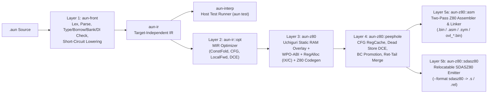

# Aun Compiler Internals

This document describes the internal architecture of the **Aun** (`aun`) compiler toolchain: its workspace crate graph, its 5-layer compilation and optimization pipeline, its static RAM overlay allocator (*Uchiguri*), its Z80 code generator and peephole optimizer, its relocatable SDASZ80 emitter, and its host IR interpreter.

---

## 1. Pipeline Overview (5-Layer Architecture)

| Layer | Crate / Module | Input -> Output | Core Responsibilities |
|---|---|---|---|
| **1. Frontend** | `crates/aun-front/src/{lexer,parser,ast,check,diag}.rs` | `.aun` -> `IrProgram` | Lexing, recursive-descent parsing, strict-width typing, second-class borrow/aliasing checks, bank/DI safety, state machine transition verification, direct short-circuit `&&`/`||`/`!` CFG lowering (`lower_cond`). |
| **2. MIR Optimizer** | `crates/aun-ir/src/{lib,opt}.rs` | `IrProgram` -> `IrProgram` | Target-independent fixed-point MIR optimization: constant folding, CFG simplification (trampoline threading, dead/merged blocks), intra-BB `StoreLocal -> LoadLocal` forwarding, liveness-verified copy coalescing, pure SSA DCE. |
| **3. Allocation & Codegen** | `crates/aun-z80/src/{uchiguri,codegen}.rs` | `IrProgram` -> Z80 ASM + `RamLayout` | *Uchiguri* call-graph static RAM overlay, ISR isolation, static stack depth verification, WPO-ABI (`A`/`HL`, `E`/`DE`), `IX` reference-param promotion, `C` hot-local allocation + WPO `clobbers_c`, shared `__aun_mul_hl_<K>` helpers, check elimination (`--release`). |
| **4. Peephole Optimizer** | `crates/aun-z80/src/peephole.rs` | Z80 ASM -> Z80 ASM | 7-stage convergence loop: local Z80 idioms (`inc/dec (ix+d)`, `inc/dec (hl)`, `inc/dec c`, `xor a`, `or a`), CFG-aware `RegCache` reload elimination, dead private-slot & single-block scratch DCE, `BC` spill promotion, `ret`-tail merging, jump threading. |
| **5. Emission & Linking** | `crates/aun-z80/src/{asm,sdasz80,lib}.rs` | Z80 ASM -> `.bin` / `.s` | Built-in Zilog+SDASZ80 two-pass assembler, `JP->JR` relaxation, T-state accounting, multi-binary `#[overlay(Slot)]` linking, or relocatable SDCC `--sdcccall(1)` SDASZ80 `.s` output (`--format sdasz80`). |
| **Host Interpreter** | `crates/aun-interp/src/lib.rs` | `IrProgram` -> Test Results | Flat virtual memory execution of `#[test]` / `#[should_panic(...)]` with exact fixed-point/wrapping/saturating arithmetic, runtime trap checks, and virtual port I/O. |

---

## 2. Layer 1: Frontend (`crates/aun-front`)

- **Lexing & Parsing** (`lexer.rs`, `parser.rs`, `ast.rs`):
  - Parses Aun's Rust-like syntax plus hardware-first declarations: `target`, `machine` (with `on <State>` methods and `#[smc]`), `extern "asm"` with explicit register bindings (`in A`, `in HL`, `clobbers(...)`), `with bank(...)`, `#[interrupt(...)]`, `#[overlay(...)]`, `#[layout(soa, align(N))]`, `const`, and `static mut`.
- **3-Pass Semantic Analysis & Lowering** (`check.rs`):
  - **Declarations**: Resolves `target` memory/bank/stack/interrupt specs, structs/enums, state machines, `extern "asm"` signatures, scalar `const`s vs. ROM `const` aggregates (`[T; N]` / structs lowered to `IrGlobal { in_rom: true }` with 0 RAM), `static` RAM globals, and functions.
  - **Strict Typing & Coercion**: Rejects implicit integer widening/narrowing (`as` required); allows implicit `&mut T -> &T` coercion at function call sites.
  - **Second-Class Borrow & Aliasing Checker**: Ensures `&T` / `&mut T` cannot escape into structs, globals, or return values, and rejects overlapping mutable borrows while permitting disjoint struct fields.
  - **Bank & Interrupt Safety**: Verifies `requires(bank(...))` and `requires(di)` across `with bank(...)` scopes and `#[interrupt]` ISRs.
  - **Direct Short-Circuit Lowering (`lower_cond`)**: Lowers `&&`, `||`, and `!` inside `if` and `while` conditions directly into `Terminator::Branch` edges, avoiding temporary boolean locals and materialization code.
  - **Intrinsics**: Lowers `io_in`, `io_out`, `mem_read_u8`, `mem_read_u16`, `addr_of`, `is_state!`, `assert!`, and `asm!`.

---

## 3. Layer 2: Middle-End IR & MIR Optimizer (`crates/aun-ir`)

### IR Representation (`crates/aun-ir/src/lib.rs`)
- `IrProgram` holds `target`, `structs`, `machines`, `globals` (`in_rom`, `soa`, `align`, `space`, `init`), `externs`, `functions`, and interned source `sites: Vec`.
- `IrFunction` is a CFG of `BasicBlock`s (`Vec<IrInst>` + `Terminator::{Unreachable, Return, Goto, Branch}`).
- Safety metadata (`ArithMode::{Checked, Wrapping, Saturating}`, `site_id`, array `len`, pool `capacity`) is embedded directly on instructions so debug/release check elimination is a clean codegen switch.

### Fixed-Point MIR Optimizer (`crates/aun-ir/src/opt.rs`)
`optimize_program` runs up to 8 fixed-point iterations per function before *Uchiguri* and Z80 codegen:

1. **`fold_constants`**: Folds `UnOp::Not` on `ConstBool`, `Cast` on `ConstInt`, and `BinOp` (comparisons, bitwise ops, and wrapping `Add`/`Sub`) on `ConstInt` pairs with exact integer-width truncation.
2. **`simplify_cfg`**:
   - Folds constant `Branch(ConstBool)` and identical-target `Branch(t, t)` into `Goto`.
   - Threads empty `Goto` trampoline blocks with cycle guards.
   - Prunes unreachable blocks via BFS from entry block `0`.
   - Merges single-predecessor `Goto` chains (`A -> B` when `in_deg(B) == 1 && B != entry`), exposing intra-BB forwarding and CSE across former block boundaries.
3. **`forward_and_coalesce_locals`**:
   - Intra-BB `StoreLocal -> LoadLocal` forwarding and dead same-BB overwrite removal for non-address-taken locals.
   - **Liveness-verified copy coalescing**: Rewrites single-read temporary locals (`__if_tmp -> dst`) directly in MIR after verifying via backward CFG liveness that no `StoreLocal(tmp, ...)` can execute while `dst` is live.
   - Dead `StoreLocal` elimination for unread non-escaping locals.
4. **`dce`**: Eliminates side-effect-free SSA instructions with 0 uses (preserving trapping `Checked` arithmetic, `Div`/`Rem`, `IndexAddr`, `Call`, `ExternCall`, `PortIn`, and `Pool*` operations).

---

## 4. Layer 3: *Uchiguri* Allocator & Z80 Codegen (`crates/aun-z80`)

### *Uchiguri* Static RAM Overlay (`crates/aun-z80/src/uchiguri.rs`)
Because the Z80 has no cheap stack-frame addressing (`(ix+d)` is 3 bytes / 19 T-states), Aun places non-reentrant function frames in static RAM overlaid by the static call graph:

- **Global Placement**: ROM `const` aggregates (`in_rom: true`) occupy 0 RAM; banked globals are placed within their declared `bank_group` bounds; unbanked globals are packed sequentially from `ram_base` (automatically shifted out of switchable bank windows if needed).
- **Intra-Function Coloring**:
  - `color_fn_locals`: Non-escaping locals are byte-range interval-colored across flattened instruction positions (conservatively extended across loop back-edges). Locals promoted to `IX` or `C` allocate 0 RAM.
  - `color_fn_scratch`: Byte-packed (1 B vs. 2 B) interval coloring for single-block SSA values (shared across all blocks and exported as `fn_sb_scratch_ranges`), plus dedicated slots for cross-block SSA values. Always-folded constants/addresses, aliased local/`IX`/`C` loads, and fused compare-branches allocate 0 scratch bytes.
- **Call-Graph Overlay & ISR Isolation**:
  - Bottom-up DFS computes `fn_overlay_offset[u] = max(child_end)` so sibling functions share the exact same RAM addresses; non-`#[reentrant]` recursion is rejected at compile time.
  - ISR-reachable functions are placed strictly above `main_end` (zero RAM overlap with main-thread code); non-`#[reentrant]` functions reachable from both `main` and an `#[interrupt]` ISR are rejected.
  - Static stack depth (`max_stack_bytes`) accounts for `CALL` return addresses, ISR register saves (+12 B), callee-saved `IX` (+2 B), and caller-saved `BC` (+2 B), checked against `target.stacks`.

### WPO-ABI, Register Promotion & Codegen (`crates/aun-z80/src/codegen.rs`)
- **Calling Convention (WPO-ABI)**:
  - Parameter 0: `A` (1 B) or `HL` (2 B).
  - Parameter 1 (regular functions): `E` (1 B) or `DE` (2 B).
  - Remaining parameters: written directly into the callee's *Uchiguri* parameter slots.
  - Return value: `A` (1 B) or `HL` (2 B).
- **Register Promotion**:
  - **`IX` Reference-Parameter Promotion** (`detect_ix_param`): Promotes a `&T`/`&mut T` param 0 or 1 to `IX`, lowering struct field accesses to `(ix + d)` and lazy same-block `ix_val_loads` (direct `add/sub/and/or/xor/cp (ix + d)` and 16-bit `ld e,(ix+d); ld d,(ix+d+1)`). Callee-saved (`push ix`/`pop ix`) whenever non-leaf, `pub`, or any non-leaf function uses `IX`.
  - **`C` Hot-Local Allocator** (`compute_reg_c_slot`) + **WPO `clobbers_c`** (`compute_fn_clobbers_c`): Promotes the hottest eligible 1-byte non-escaping local per function to register `C` (0 RAM, 1-byte `ld a, c` / `cp c` / `add a, c` / `inc c` / `dec c`). Whole-program call-graph analysis skips `push bc`/`pop bc` around internal calls that do not clobber `C`.
- **Codegen Optimizations**:
  - Dominance-preserving greedy fallthrough BB layout (`compute_bb_order`).
  - Fused compare-branch (`emit_fused_cmp_branch`) with Z80 idioms (`or a`, `ld a, h; or l`, `bit 7`, signed 8-bit `x > 0` via `dec a; cp 0x7F`, unsigned `x > C` via `cp C+1`).
  - ROM `AddrGlobal` / `FieldAddr` / constant-index `IndexAddr` folding (`ld de, #(SYM + off)`).
  - Same-BB `IndexAddr` CSE (`IndexKey::RegC | IndexKey::Mem(addr, size)`) and 16-bit constant shift CSE.
  - Shared `__aun_mul_hl_<K>` outlined helpers for repeated non-power-of-two struct strides (`k >= 5`, count >= 2).
  - `CompileOptions` (`--release` / `--checks=...`) strips bounds, handle, overflow, and transition checks plus `_tmask` tables and `__aun_panic`.

---

## 5. Layer 4: Z80 Peephole Optimizer (`crates/aun-z80/src/peephole.rs`)

`optimize_asm_full` iterates up to 10 passes until convergence, consuming `fn_private_ranges`, `fn_sb_scratch_ranges`, and `no_bc_fns`:

1. **`run_pass`**: Local Z80 idioms (`ld r, r` removal, `cp 0` -> `or a`, flag-dead `ld a, 0` -> `xor a`, `inc/dec (ix+d)` with Z-flag test fusion, `inc/dec (hl)`, `inc/dec c`, `call f; ret` -> `jp f`).
2. **`eliminate_redundant_reg_reloads`**: CFG-aware `RegCache` tracking `(0xXXXX)` in `HL`/`DE`/`A` and `(ix + d)` in `HL` across forward-DAG `_bb<N>` edges via predecessor intersection; preserves `hl_ix_disp` across writes to the current function's private RAM (`cur_private`).
3. **`eliminate_dead_scratch_stores` & `eliminate_dead_bb_scratch_stores`**: Removes stores to unread private slots and backward-dead single-block scratch stores (conservative across synthetic intra-block labels and conditional branches).
4. **`promote_single_block_spills_to_bc`**: Replaces single-block `ld (addr), hl` / `ld hl, (addr)` pairs with `ld b, h; ld c, l` / `ld h, b; ld l, c` in functions not using `C`/`BC` and not in `no_bc_fns`.
5. **`merge_ret_tails` & `thread_empty_jumps`**: Cross-jumps identical `ret` tails and threads empty `jp` trampolines with cycle guards.

---

## 6. Layer 5: Relocatable Emitter, Assembler & Linker

- **Relocatable SDASZ80 Emitter** (`crates/aun-z80/src/sdasz80.rs`, `--format sdasz80`):
  - Emits `.module`, `.optsdcc -mz80 sdcccall(1)`, `.area _DATA` (`__aun_ram: .ds N`), `.area _CODE`, and `.globl` directives.
  - Rewrites fixed *Uchiguri* RAM addresses into `(__aun_ram + off)` and translates Zilog syntax to SDASZ80 (`#imm`, `#(SYM + off)`, `d(ix)`).
  - Generates SDCC `--sdcccall(1)` C ABI `_name::` wrappers for `pub fn`s (`ex de, hl` for 2-byte returns, general `iy`/`bc` stack-arg unpacker for `param_count > 2`).
  - Performs conservative byte-bounded intra-function `jp` -> `jr` relaxation.
- **Built-in Z80 Assembler & Multi-Binary Linker** (`crates/aun-z80/src/{asm,lib}.rs`):
  - Two-pass Zilog + SDASZ80 `.s` assembler with fixed-point `JP`->`JR` relaxation and per-function T-state accounting.
  - Assembles resident code plus per-state `#[overlay(Slot)]` binaries and validates overlay slot capacities.

---

## 7. Host IR Interpreter & CLI Driver

- **`crates/aun-interp/src/lib.rs`**: Executes `IrProgram` directly in a flat virtual byte address space for `aun test`, validating `#[test]`, `#[should_panic(expected = "...")]`, fixed-point/saturating/wrapping semantics, bounds/handle/transition traps, and virtual port I/O.
- **`crates/aun-cli/src/main.rs`**: Provides `aun build` (`--release`, `--checks=...`, `--format bin|sdasz80`, `-o <dir>`), `aun test`, and `aun inspect`.
